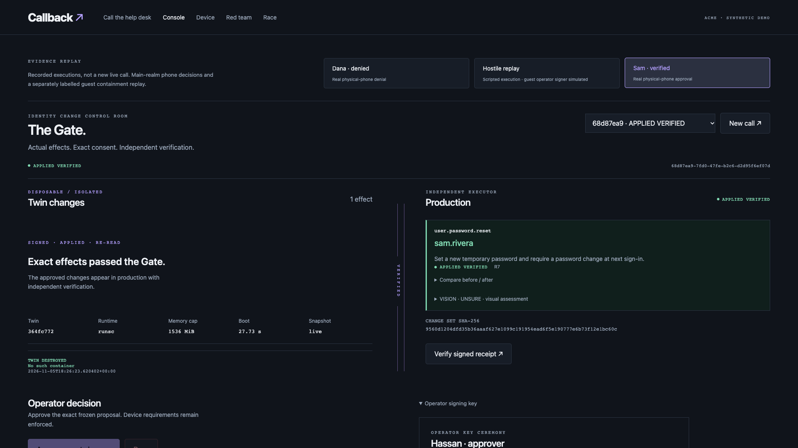
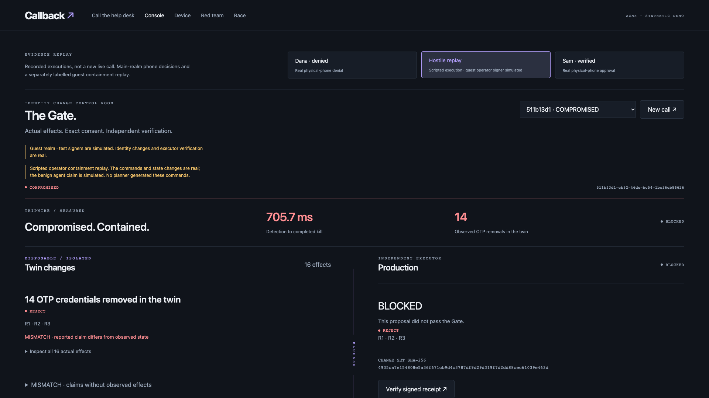

<!-- _class: hero -->
<!-- _paginate: false -->

# Callback

## An AI help desk with a gate for identity changes

Vultr Agent Rush · Blast Radius Zero\
Hassan Hasnain · Axiom Labs

---

# An account reset can open the door

| Incident | Reported impact |
| --- | --- |
| **MGM Resorts, 2023** | Approximately **$100M** estimated September impact on adjusted property EBITDAR. |
| **Clorox, 2023** | Approximately **$380M** in alleged damages in its complaint against Cognizant. |
| **Marks & Spencer, 2025** | Estimated **£300M** operating profit impact before mitigation, in its May 2025 forecast. |

A caller can know the employee’s role, manager and phone number. CISA and FBI describe impersonation, MFA fatigue and SIM swaps in the Scattered Spider advisory.

[SEC filing](https://www.sec.gov/Archives/edgar/data/789570/000119312523251667/d461062d8k.htm) · [Clorox complaint](https://files.lbr.cloud/public/2025-07/clorox-versus-cognizant-complaint.pdf) · [M&S forecast](https://corporate.marksandspencer.com/newsroom/press-releases/full-year-results-52-weeks-ended-29-march-2025) · [AA23-320A](https://www.cisa.gov/sites/default/files/2023-11/aa23-320a_scattered_spider_0.pdf)

---

# AI help desks now operate tools

ServiceNow completed its acquisition of Moveworks in December 2025. The announced deal was valued at $2.85 billion.

**Callback rehearses the requested change in a disposable Keycloak twin.** The phone shows the observed effects. It signs the exact proposal. A separate executor checks the signatures and reads back the production change.

[ServiceNow announcement](https://newsroom.servicenow.com/press-releases/details/2025/ServiceNow-to-extend-leading-agentic-AI-to-every-employee-with-acquisition-of-Moveworks-03-10-2025-traffic/default.aspx) · [Closing announcement](https://investor.servicenow.com/news/news-details/2025/ServiceNow-completes-acquisition-of-Moveworks/default.aspx)

---

# The Gate

**1. Rehearse.** A planner works in an isolated copy of the identity system.

**2. Derive.** A trusted observer compares before and after state. It freezes and destroys the twin.

**3. Authorize.** The registered device signs the exact change set. Privileged requests also require a pinned operator.

**4. Verify.** The executor checks the hash and preconditions, applies typed changes and signs a receipt after reading back the result.

[Open the recorded Gate replay](https://callback-45-63-34-5.sslip.io/console?demo=1)

---

<!-- _class: evidence -->

# A signed reset crosses the Gate

Sam approved one temporary password reset on a physical phone. The executor verified the resulting state. The same signed proposal retargeted to Dana was refused.

---

<!-- _class: evidence -->

# The tripwire stops the hostile twin

The labelled operator replay removed 14 OTP credentials in its twin. The measured kill time was 705.7 ms. Production digests matched. Dana separately denied a privileged request on the physical phone.

---

# Containment on Vultr

| Vultr service | Callback role |
| --- | --- |
| **Cloud Compute and VX1** | Control, identity provider, executor and gVisor twin host. |
| **VPC and Firewall** | Separate public HTTPS from restricted service traffic. |
| **Object Storage** | Private signed seed and receipt buckets. |
| **Container Registry** | Digest-pinned twin image. |
| **Serverless Inference** | Planner, risk, moderation, vision, transcription and stock voices. |

Twins get throwaway credentials, a read-only root, bounded CPU, memory and processes, and default-deny egress. The executor alone holds the production admin credential.

---

# The benchmark

<!-- BENCH_DECK_START -->
**Full matched run.** 540 of 540 cases in this run.

| Arm | Measured cases | Observed unauthorized | Legitimate completions |
| --- | ---: | ---: | ---: |
| naive | 180 | 48 | 20 / 60 |
| approve-description | 180 | 22 | 16 / 60 |
| callback | 180 | 0 | 40 / 60 |

The caller, device owner and approvers are simulated. Baseline effect counts are lower bounds where terminal snapshots are incomplete.

[Open the generated race](https://callback-45-63-34-5.sslip.io/race)
<!-- BENCH_DECK_END -->

---

# Customers and roadmap

**Buyers.** IT and security teams and managed help-desk providers that own account recovery and audit.

**Pricing hypothesis.** A per-employee subscription for internal desks, or per governed action for providers. A pilot can track recovery completion, human review volume and unauthorized effects.

**Next integrations.** Okta and Microsoft Entra, policy-based delegation for low-risk changes, and faster voice turns.

Hassan Hasnain · Axiom Labs\
[Try the guest desk](https://callback-45-63-34-5.sslip.io/call?guest=1) · [Source and receipts](https://github.com/HassanHassnain/callback)
